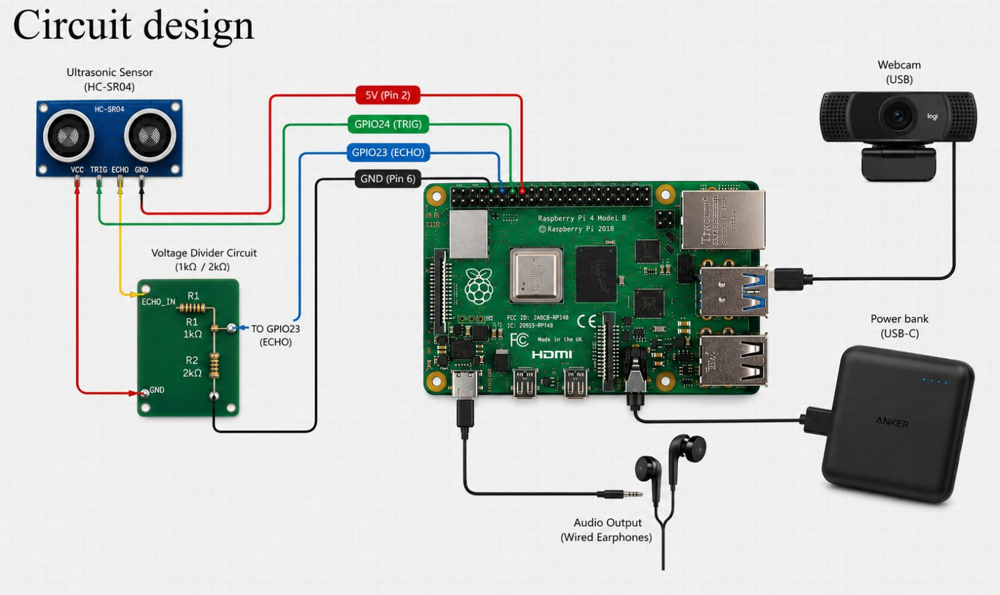
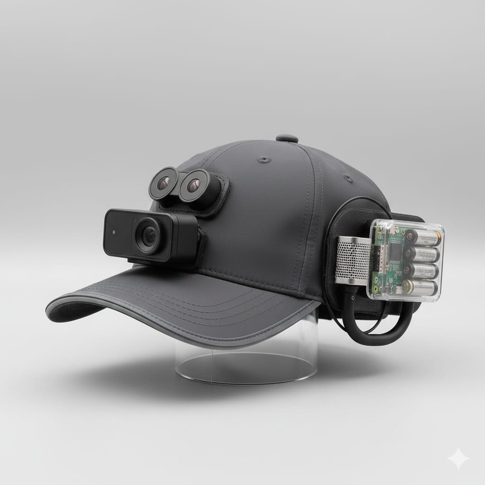

# AI-Assisted Wearable Mobility Aid for Visually Impaired

[](https://www.raspberrypi.com/products/raspberry-pi-4-model-b/)
[](https://www.tensorflow.org/lite)
[](https://opencv.org/)
[](#hardware-components)
[](https://github.com/espeak-ng/espeak-ng)
[](LICENSE)

A wearable, cap-mounted prototype that combines real-time AI object detection with ultrasonic distance measurement to help visually impaired individuals navigate obstacles. The system identifies nearby objects using a TensorFlow Lite model on a Raspberry Pi 4, measures distance with an HC-SR04 ultrasonic sensor, and delivers spoken alerts through earphones via eSpeak-NG text-to-speech.

> **Scope Notice**: This is an engineering prototype developed as a B.Tech mini project. It is not a certified assistive device and does not replace a white cane, guide dog, or trained mobility support.

---

## 📸 System Overview

| Circuit Wiring Diagram | Wearable Concept Design |
| :---: | :---: |
|  |  |
| *HC-SR04 ultrasonic sensor wired to GPIO23/24 via 1kΩ/2kΩ voltage divider. USB webcam and earphones connected directly.* | *AI-generated concept illustration of the cap-mounted wearable form factor.* |

---

## 📌 Problem Statement

Visually impaired individuals depend on white canes, guide dogs, or human assistance for safe navigation. These approaches have significant limitations in crowded environments, unfamiliar locations, and detecting obstacles at mid-range distances. Affordable, AI-driven wearable systems that provide real-time audio feedback represent a growing area of assistive technology research.

This project prototypes a wearable device combining computer vision object detection with ultrasonic proximity sensing to identify and announce nearby obstacles.

---

## 🎯 Objectives

1. Perform real-time object detection using a TFLite model on edge hardware.
2. Measure obstacle proximity using an HC-SR04 ultrasonic sensor.
3. Classify obstacles as **near** (< 80 cm), **medium** (80–200 cm), or **far** (> 200 cm).
4. Deliver spoken audio warnings via eSpeak-NG without cloud connectivity.
5. Use a temporal voting mechanism to reduce false positives before speaking.
6. Build a wearable, self-contained prototype powered by a portable power bank.

---

## ✅ Feature Status

| Feature | Status | Notes |
| :--- | :---: | :--- |
| USB webcam input via V4L2 | **Verified** | `cv2.VideoCapture(0, cv2.CAP_V4L2)` at 640×480 |
| TFLite object detection (SSD MobileNet) | **Verified** | `tflite_runtime`, `model/detect.tflite` |
| HC-SR04 ultrasonic distance measurement | **Verified** | GPIO23 (TRIG), GPIO24 (ECHO), with voltage divider |
| Near / medium / far classification | **Verified** | < 80 cm / 80–200 cm / > 200 cm |
| eSpeak-NG text-to-speech | **Verified** | `espeak-ng -s 150` piped through `aplay` |
| Temporal voting (false-positive reduction) | **Verified** | 1.5-second window, min 3 detections |
| Per-class audio grouping (vehicle, animal, person) | **Verified** | Person priority, vehicle/animal grouping |
| Audio cooldown (avoid repetition) | **Verified** | 4-second cooldown |
| Bounding-box overlay on display | **Verified** | Green rectangle + label drawn on OpenCV window |
| Wearable cap integration | **Prototype** | Physical mounting demonstrated; form factor is a prototype |
| Speech recognition / voice commands | **Not implemented** | Planned future feature |
| GPS navigation | **Not implemented** | Planned future feature |
| Emergency alert transmission | **Not implemented** | Planned future feature |

---

## 🏗️ System Architecture

```
┌─────────────────────────────────────────────────────┐
│                   Raspberry Pi 4B                   │
│                                                     │
│  USB Webcam ──► OpenCV ──► TFLite Inference         │
│                               │                     │
│                         Object + Score              │
│                               │                     │
│  HC-SR04 ────► GPIO ─────► Distance (cm)            │
│                               │                     │
│                    ┌──────────▼──────────┐           │
│                    │  Voting / Cooldown  │           │
│                    │  Decision Logic     │           │
│                    └──────────┬──────────┘           │
│                               │                     │
│                         eSpeak-NG + aplay           │
│                               │                     │
└───────────────────────────────┼─────────────────────┘
                                │
                        Earphones / Wired Audio Output
```

For a detailed Mermaid diagram and data-flow explanation, see [docs/architecture.md](docs/architecture.md).

---

## 🔩 Hardware Components

Components documented in the March 2026 project report. Costs are prototype estimates, not current market prices.

| Component | Specification | Est. Cost (₹) |
| :--- | :--- | ---: |
| Raspberry Pi 4 Model B | 4 GB RAM, Broadcom BCM2711 | 7,000 |
| Raspberry Pi case | With integrated cooling fan | 670 |
| USB Webcam | Standard UVC-compatible webcam | 800 |
| HC-SR04 Ultrasonic Sensor | 2 cm – 400 cm range, GPIO interface | — |
| Resistors (1 kΩ, 2 kΩ) | Voltage divider for ECHO pin (5V → 3.3V) | — |
| Earphones | Wired 3.5 mm audio output | 450 |
| Portable power bank | ~5 V, 4000–5000 mAh, USB-C | 1,500 |
| Jumper wires | Male-to-female for GPIO connections | — |
| Wearable cap | Fabric cap for component mounting | — |
| **Total (reported)** | | **~10,420** |

> The HC-SR04, resistors, jumper wires, and cap were not individually itemised in the cost table but are part of the working prototype.

---

## 🧠 How the System Works

### 1. Object Detection
Every second frame is resized to the model's input dimensions and run through the SSD MobileNet TFLite model. Detections below 60% confidence are discarded. Small boxes (area < 3000 px²) and objects outside a 120-pixel margin of the frame centre are ignored (except persons, which are accepted regardless of position).

### 2. Ultrasonic Distance Measurement
The HC-SR04 sensor is triggered on every processed frame. Pulse duration is converted to centimetres using `distance = duration × 17150`. Timeouts return 999 cm (treated as "far"). The ECHO pin is level-shifted from 5 V to 3.3 V using a 1 kΩ / 2 kΩ resistor voltage divider to protect the Raspberry Pi GPIO.

### 3. Proximity Classification

| Distance | Zone |
| :--- | :--- |
| < 80 cm | **near** |
| 80 – 200 cm | **medium** |
| > 200 cm | **far** |

### 4. Voting / Stability Filter
Detections are buffered for 1.5 seconds. An announcement is only made if the same object appears at least 3 times in the window. This prevents single-frame false positives from generating a spurious alert.

### 5. Audio Output
eSpeak-NG synthesises the alert at 150 wpm and writes to `/tmp/tts.wav`, which `aplay` then plays through the 3.5 mm audio jack. A 4-second cooldown prevents repetitive announcements for the same object at the same distance.

#### Example spoken outputs
| Detected scene | Audio output |
| :--- | :--- |
| Person 60 cm away | *"Person near"* |
| Car 150 cm away | *"Vehicle medium"* |
| Dog 250 cm away | *"Animal far"* |
| Chair 40 cm away | *"chair near"* |

---

## 📂 Repository Structure

```
AI-Assisted-Wearable-Mobility-Aid/
├── webcam_detect.py          # Main entry-point: detection, sensing, TTS
├── requirements.txt          # Python dependencies
├── .gitignore
├── LICENSE                   # MIT License — see note below
├── model/
│   ├── labelmap.txt          # COCO 80-class label map (committed)
│   └── detect.tflite         # NOT committed — too large; see setup guide
├── docs/
│   ├── architecture.md       # System architecture and Mermaid diagram
│   ├── hardware.md           # Hardware setup, GPIO wiring, voltage divider
│   ├── software-setup.md     # Full installation and execution guide
│   ├── methodology.md        # Object detection and distance estimation
│   ├── testing.md            # Test scenarios, demo checklist, results
│   └── images/
│       ├── circuit-design.jpeg   # HC-SR04 + RPi4 wiring diagram
│       └── cap-concept.jpeg      # Wearable form factor concept (AI-generated)
└── scripts/
    └── setup_env.sh          # Virtual environment bootstrap script
```

---

## ⚡ Quick Start

### Prerequisites
- Raspberry Pi 4 Model B running Raspberry Pi OS (Bookworm, 32-bit)
- USB webcam connected to a USB port
- HC-SR04 sensor wired to GPIO23 / GPIO24 (see [docs/hardware.md](docs/hardware.md))
- Earphones or speaker connected to the 3.5 mm audio jack
- Internet connection for initial package installation

### 1. Clone the repository

```bash
git clone https://github.com/<your-username>/AI-Assisted-Wearable-Mobility-Aid.git
cd AI-Assisted-Wearable-Mobility-Aid
```

### 2. Download the TFLite model

The `detect.tflite` file is excluded from Git due to its size. Download the SSD MobileNet v1 COCO model from the official TensorFlow repository:

```bash
mkdir -p model
wget https://storage.googleapis.com/download.tensorflow.org/models/tflite/coco_ssd_mobilenet_v1_1.0_quant_2018_06_29.zip -O /tmp/model.zip
unzip /tmp/model.zip -d /tmp/model_extracted
cp /tmp/model_extracted/detect.tflite model/detect.tflite
```

> **Note**: This is the standard COCO SSD MobileNet v1 quantised model. Verify the SHA-256 hash against the TensorFlow download page before using on a production system.

### 3. Set up the Python environment

```bash
python3 -m venv blind_env
source blind_env/bin/activate
pip install --upgrade pip
pip install -r requirements.txt
```

For TFLite runtime installation and system package dependencies, see [docs/software-setup.md](docs/software-setup.md).

### 4. Run the system

```bash
source blind_env/bin/activate
python3 webcam_detect.py
```

Press **Q** in the OpenCV window to stop. Use **Ctrl+C** in the terminal for keyboard interrupt. GPIO cleanup runs automatically in both cases.

---

## 🧪 Testing & Results

Detection results from the project report (March 2026):

| Multi-Object + Phone Detection | Chair Detection |
| :---: | :---: |
|  |  |
| *person 0.87 · cell phone 0.75 · car 0.54 (top); cell phone 65% (bottom)* | *chair: 68%* |

See [docs/testing.md](docs/testing.md) for the full demo checklist, test scenarios, and qualitative results.

---

## ⚠️ Known Limitations

1. **Single-object focus**: Only the largest/highest-priority detection per frame is announced. Multiple simultaneous obstacles are not individually reported.
2. **HC-SR04 field of view**: The ultrasonic sensor covers a ~15° cone directly ahead. Objects outside this cone receive a distance of 999 cm.
3. **TTS latency**: eSpeak-NG speech synthesis adds a small delay. The cooldown timer compensates, but rapid obstacle changes may lag audio feedback.
4. **Lighting sensitivity**: The USB webcam performs poorly in very low light. Detection accuracy degrades at night or in dim corridors.
5. **No calibrated distance accuracy**: The ultrasonic formula `distance = duration × 17150` assumes 25 °C ambient temperature. Accuracy decreases at significantly different temperatures.
6. **No voice commands**: Speech recognition is not implemented in the current prototype.
7. **No GPS or spatial mapping**: Navigation guidance is limited to immediate obstacle alerts.

---

## 🔭 Future Improvements

Priority order based on impact and feasibility:

1. **Multiple obstacle announcements** — Report the two or three nearest obstacles per frame, not just the largest.
2. **Stereo or wide-angle camera** — Wider field of view to reduce blind spots.
3. **Offline speech recognition** — Integrate Vosk or similar for voice command control (start, stop, sensitivity).
4. **Directional audio** — Report whether an obstacle is to the left, right, or centre using bounding-box horizontal position.
5. **Calibrated temperature compensation** — Adjust ultrasonic speed-of-sound formula using an onboard temperature sensor.
6. **systemd service** — Auto-start on Raspberry Pi boot without manual terminal access.
7. **Bone-conduction headset** — Replace earphones to allow ambient sound awareness.
8. **Depth camera integration** — Replace ultrasonic sensor with an Intel RealSense or similar for per-pixel depth estimation.
9. **Custom lightweight model** — Train a domain-specific model on obstacle categories most relevant to pedestrian environments.
10. **Emergency alert** — Send a distress signal via mobile data or Bluetooth if the user presses a button.

---

## 👥 Project Team

Developed as a B.Tech Mini Project in the **Department of Electronics and Computer Engineering**, **Saintgits College of Engineering (Autonomous)**, Kottayam, Kerala — March 2026.

| Member | Reg. No. | Contributions |
| :--- | :---: | :--- |
| **Afna A** | MGP23ECE006 | Component research, hardware specifications, implementation methods, literature review |
| **Aswin S** | MGP23ECE018 | Software development (`webcam_detect.py`), hardware design, system integration |
| **Ebin Soyan Thomas** | MGP23ECE020 | Dataset collection, software coding, literature review |
| **Juliya Augustine** | MGP23ECE033 | Dataset collection, system setup and installation, documentation, literature review |

**Project Supervisor**: Er. Anish M George, Assistant Professor, Department of Electronics Engineering, Saintgits College of Engineering.

---

## 📚 References

1. Howard, A. G., Zhu, M., et al. (2017). *MobileNets: Efficient Convolutional Neural Networks for Mobile Vision Applications*. arXiv:1704.04861.
2. TensorFlow Lite documentation — <https://www.tensorflow.org/lite/guide>
3. OpenCV documentation — <https://docs.opencv.org/>
4. Raspberry Pi 4 Model B documentation — <https://www.raspberrypi.com/documentation/>
5. eSpeak NG documentation — <https://github.com/espeak-ng/espeak-ng/blob/master/docs/>
6. HC-SR04 Ultrasonic Sensor datasheet — Elec Freaks / generic manufacturer datasheet.
7. Mukherjee, S., & Acharya, T. (2020). *Smart assistive navigation system for visually impaired using deep learning and sensory substitution*. IEEE Access.
8. Liu, W., Anguelov, D., et al. (2016). *SSD: Single Shot MultiBox Detector*. ECCV 2016.

> Some references are cited from the project report as supplied. DOIs and full publication details should be verified against academic databases before use in formal citation.

---

## ⚖️ License

This project is licensed under the **MIT License** — see the [LICENSE](LICENSE) file for details.

> **Disclaimer**: This is an educational engineering prototype. The system is not a certified medical or assistive device. It must not be used as the sole means of navigation for visually impaired persons. Always test in a controlled environment with a sighted supervisor present.
