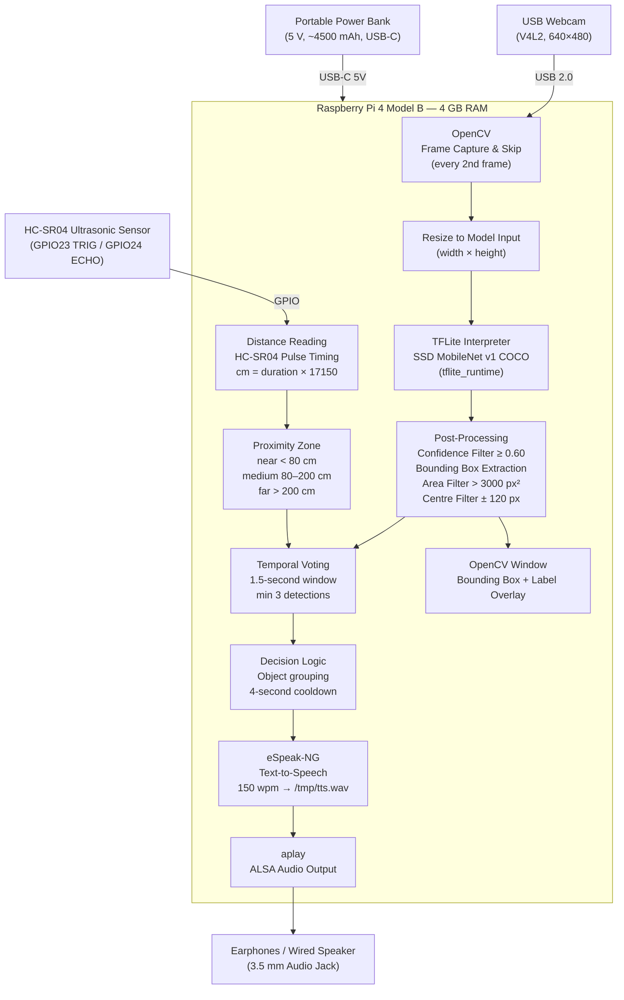

# System Architecture & Data Flow

This document describes the hardware and software architecture of the AI-Assisted Wearable Mobility Aid, the data flow through each processing stage, and the design rationale behind key decisions.

---

## Overview

The system is entirely self-contained on a single Raspberry Pi 4B. All AI inference, sensor reading, decision logic, and audio output run locally. No cloud connectivity is required during operation.

Two sensor modalities work in parallel on each processed frame:
- **USB webcam + TFLite model** → Object class and bounding box
- **HC-SR04 ultrasonic sensor** → Physical distance in centimetres

The outputs are fused in the decision layer to produce a spoken alert.

---

## System Block Diagram



---

## Stage-by-Stage Data Flow

### Stage 1 — Frame Acquisition

```python
cap = cv2.VideoCapture(0, cv2.CAP_V4L2)
cap.set(cv2.CAP_PROP_FRAME_WIDTH, 640)
cap.set(cv2.CAP_PROP_FRAME_HEIGHT, 480)
```

The USB webcam is opened via the Video4Linux2 (V4L2) backend at 640×480. Every second frame is skipped (`FRAME_SKIP = 2`) to reduce CPU load while maintaining a responsive detection rate.

---

### Stage 2 — Ultrasonic Distance Measurement

On each processed frame, the HC-SR04 is triggered simultaneously with the camera frame. The ECHO pulse duration is measured and converted:

```
distance_cm = pulse_duration_seconds × 17150
```

This formula assumes the speed of sound at approximately 25 °C (~343 m/s). The distance is then classified:

| Condition | Zone |
|:---|:---|
| `distance_cm < 80` | **near** |
| `80 ≤ distance_cm < 200` | **medium** |
| `distance_cm ≥ 200` | **far** |
| Timeout (> 30 ms) | returns 999 → treated as **far** |

> **Accuracy note**: This is not a calibrated scientific measurement. Temperature, humidity, and sensor tolerances introduce error. The zones are practical thresholds, not exact distances.

---

### Stage 3 — Frame Preprocessing

The captured BGR frame is resized to the model's native input dimensions, which are read at runtime from `input_details[0]['shape']`:

```python
frame_resized = cv2.resize(frame, (width, height))
input_data = np.expand_dims(frame_resized, axis=0)
```

For the standard SSD MobileNet v1 COCO model, this is typically **300×300**.

---

### Stage 4 — TFLite Inference

The `tflite_runtime` interpreter runs the quantised model on the preprocessed frame:

```python
interpreter.set_tensor(input_details[0]['index'], input_data)
interpreter.invoke()
boxes   = interpreter.get_tensor(output_details[0]['index'])[0]
classes = interpreter.get_tensor(output_details[1]['index'])[0]
scores  = interpreter.get_tensor(output_details[2]['index'])[0]
```

Output tensors:
- `boxes` — normalised `[ymin, xmin, ymax, xmax]` coordinates
- `classes` — class index (0-indexed into the COCO 80-class set)
- `scores` — confidence score per detection

---

### Stage 5 — Post-Processing & Object Selection

Each detection passes through a series of filters:

| Filter | Threshold | Purpose |
|:---|:---|:---|
| Confidence | ≥ 0.60 | Reject low-confidence detections |
| Box area | > 3000 px² | Reject tiny / distant objects |
| Centre alignment | ± 120 px from frame centre | Focus on objects directly ahead (non-persons) |
| Ignore list | `["suitcase"]` | Suppress known false-positive class |

From surviving detections, the system selects the **single best object** per frame:
- Persons receive a +1,000,000 bonus to their area score (always prioritised)
- Among non-persons, the largest bounding box wins

---

### Stage 6 — Temporal Voting

To prevent single-frame false positives from generating a spoken alert, detections are accumulated in a rolling buffer over a 1.5-second window. An announcement is only triggered when the same object class appears **at least 3 times** in that window.

```
Voting window = 1.5 s
Minimum detections = 3
```

---

### Stage 7 — Decision Logic & Audio Output

On a stable detection, the system determines the spoken message:

| Object class | Spoken output |
|:---|:---|
| `person` | *"Person \<zone\>"* |
| `car`, `bus`, `truck` | *"Vehicle \<zone\>"* |
| `dog`, `cat`, `cow`, `horse` | *"Animal \<zone\>"* |
| Any other class | *"\<class name\> \<zone\>"* |

A **4-second cooldown** prevents the same `<object> <zone>` message from repeating. A new message fires immediately if the object or zone changes.

Speech is synthesised by eSpeak-NG at 150 wpm and played via ALSA:

```bash
espeak-ng -s 150 "Person near" > /tmp/tts.wav && aplay /tmp/tts.wav
```

---

## Design Decisions

| Decision | Rationale |
|:---|:---|
| Ultrasonic sensor instead of bounding-box-only distance | Bounding-box area is unreliable across different object sizes and aspect ratios. HC-SR04 provides a direct physical measurement at low cost. |
| Temporal voting instead of per-frame announcements | Eliminates audio noise from transient false detections in busy scenes. |
| Single-object selection per frame | Avoids simultaneous TTS collisions; simplifies audio logic. |
| `tflite_runtime` instead of full TensorFlow | Smaller dependency; sufficient for inference-only on ARM. |
| espeak-ng + aplay pipeline | Pure offline TTS; no network requirement; compatible with Raspberry Pi OS ALSA. |
| FRAME_SKIP = 2 | Reduces CPU load; at typical camera framerates the latency added is < 70 ms. |

---

## Modules Not Implemented

The following components were described in the project proposal but are not present in the current codebase:

| Module | Status |
|:---|:---|
| Speech recognition / voice commands | Not implemented |
| GPS / spatial mapping | Not implemented |
| Emergency alert transmission | Not implemented |
| Bone-conduction headset interface | Not implemented (earphone output only) |
| Microphone input | Not implemented |
