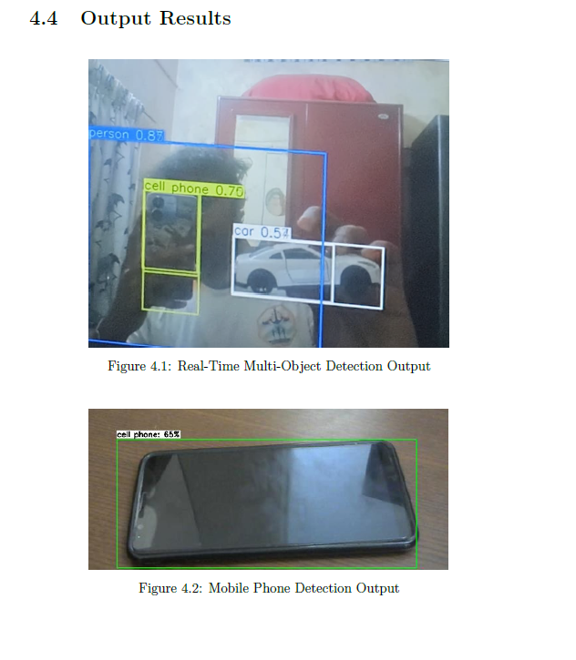
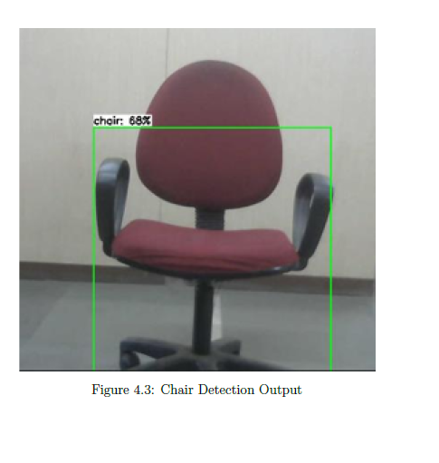

# Testing & Demonstration Guide

This document describes the test scenarios conducted during the project, qualitative observations from the March 2026 project report, and a practical checklist for reproducing and demonstrating the system.

---

## Implementation Verification Status

The following table separates what was observed during implementation from what was formally benchmarked.

| Test | Verification Method | Status |
| :--- | :--- | :---: |
| System startup TTS ("System ready") | Auditory confirmation | ✅ Verified |
| USB webcam frame capture at 640×480 | OpenCV `isOpened()` + visual frame | ✅ Verified |
| TFLite model loading and tensor allocation | No exception on startup | ✅ Verified |
| Person detection with bounding box | Visual inspection of OpenCV window | ✅ Verified |
| Multi-object detection | Visual inspection (multiple boxes) | ✅ Verified |
| Mobile phone detection | Visual inspection | ✅ Verified |
| Chair detection | Visual inspection | ✅ Verified |
| HC-SR04 distance measurement | Auditory output ("near"/"medium"/"far") | ✅ Verified |
| eSpeak-NG audio output | Auditory confirmation through earphones | ✅ Verified |
| Temporal voting (reduced false positives) | Qualitative observation during testing | ✅ Verified |
| Suitcase false-positive suppression | Object removed from detections | ✅ Verified |
| Audio cooldown (no repeated messages) | Qualitative observation | ✅ Verified |
| Graceful exit on 'Q' press or Ctrl+C | GPIO.cleanup() confirmed | ✅ Verified |
| Measured inference latency | Not benchmarked | ⬜ Unverified |
| Measured distance accuracy ±cm | Not benchmarked | ⬜ Unverified |
| Detection accuracy (mAP) | Not benchmarked | ⬜ Unverified |
| Performance in low-light conditions | Not formally tested | ⬜ Unverified |
| Multi-hour continuous operation stability | Not formally tested | ⬜ Unverified |

---

## Test Scenarios (from Project Report)

### Scenario 1 — Multi-Object Detection

The system was presented with a scene containing multiple objects simultaneously. The OpenCV display showed multiple bounding boxes with labels and the proximity zone. The voting system correctly selected the dominant/largest object for the audio announcement rather than announcing multiple simultaneous alerts.

**Result (qualitative)**: Person correctly prioritised over background objects.

### Scenario 2 — Mobile Phone Detection

A mobile phone was held in front of the camera within approximately 30–50 cm (ultrasonic sensor confirmed "near"). The model correctly classified the object as `cell phone` and the system spoke *"cell phone near"*.

**Result (qualitative)**: Detection confirmed; audio output confirmed.

### Scenario 3 — Chair Detection

A chair was placed approximately 60 cm in front of the camera. The system detected it as `chair` and announced *"chair near"*.

**Result (qualitative)**: Detection confirmed; audio output confirmed.

---

## Detection Result Images

The following images are from the project report (March 2026). They show the live OpenCV window with bounding boxes and confidence scores overlaid on the camera feed.

### Figure 4.1 & 4.2 — Multi-Object Detection + Mobile Phone

*Figure 4.1 (top): Three simultaneous detections — `person 0.87`, `cell phone 0.75`, `car 0.54`. Each class receives a separate bounding box. Figure 4.2 (bottom): Isolated mobile phone detection with `cell phone: 65%` confidence.*

### Figure 4.3 — Chair Detection

*Figure 4.3: Chair correctly detected and labelled with `chair: 68%` confidence and a green bounding box.*

---

## Demo Checklist

Use this checklist when demonstrating the system on physical hardware:

### Pre-Demo Setup

- [ ] Power on the Raspberry Pi
- [ ] Wait for boot (30–60 seconds)
- [ ] SSH into the Pi or connect a keyboard and monitor
- [ ] Confirm USB webcam is connected: `ls /dev/video0`
- [ ] Confirm HC-SR04 is wired with voltage divider on ECHO
- [ ] Confirm earphones are plugged into 3.5 mm jack
- [ ] Navigate to project directory: `cd ~/AI-Assisted-Wearable-Mobility-Aid`
- [ ] Activate virtual environment: `source blind_env/bin/activate`
- [ ] Confirm model file exists: `ls model/detect.tflite`

### Running the Demo

- [ ] Start the system: `python3 webcam_detect.py`
- [ ] Listen for startup message: *"System ready"*
- [ ] Confirm the OpenCV window appears with live camera feed

### Functional Verification Steps

1. **Stand in front of the camera at ~50 cm** → Expect: *"Person near"*
2. **Step back to ~150 cm** → Expect: *"Person medium"*
3. **Step back to ~250 cm** → Expect: *"Person far"*
4. **Hold a chair at 60 cm in front of the sensor** → Expect: *"chair near"*
5. **Hold a mobile phone at 40 cm** → Expect: *"cell phone near"*
6. **Cover the ultrasonic sensor completely** → Returns 999 cm → Expect: zone = "far"
7. **Move an object quickly in and out of frame** → Expect: no announcement (voting suppresses transient detections)
8. **Hold the same object steady for 3+ seconds** → Expect: consistent announcement

### Lighting Conditions

- [ ] Test in normal indoor lighting
- [ ] Test in bright outdoor light
- [ ] Note any degradation in dim lighting

### Observations to Record

- [ ] Any objects incorrectly identified (false positives)
- [ ] Objects not detected at expected range (false negatives)
- [ ] Audio latency relative to obstacle appearance
- [ ] Ultrasonic readings for soft/fabric surfaces (may time out)
- [ ] Behaviour when multiple people are in frame

### Exit

- [ ] Press **Q** in the OpenCV window, OR
- [ ] Press **Ctrl+C** in terminal
- [ ] Confirm: GPIO.cleanup() completes without error
- [ ] Earphones disconnected safely

---

## Qualitative Results Summary

| Observation | Outcome |
| :--- | :--- |
| Object detection responsiveness | Alert delivered within ~2–3 seconds of stable object presentation |
| Distance zone accuracy | Qualitatively consistent with physical measurements for person-sized objects |
| Voting filter effectiveness | Eliminated transient false positives in informal testing |
| TTS intelligibility | Speech clear at 150 wpm through earphones in quiet environments |
| Ultrasonic soft-surface behaviour | Fabric and carpet surfaces may return 999 cm (treated as "far") |
| Wearable comfort | Prototype not ergonomically optimised; weight distribution needs improvement |

---

## Safety Advisory

> ⚠️ **This is an engineering prototype, not a certified assistive device.**
>
> - Always test in a controlled, obstacle-free environment before use near people.
> - A sighted supervisor should be present during all testing sessions.
> - Do not use this system as the sole means of navigation in any real-world setting.
> - The system does not detect floor-level obstacles (steps, kerbs) or overhead hazards.
> - HC-SR04 performance degrades on soft or sound-absorbing surfaces.
